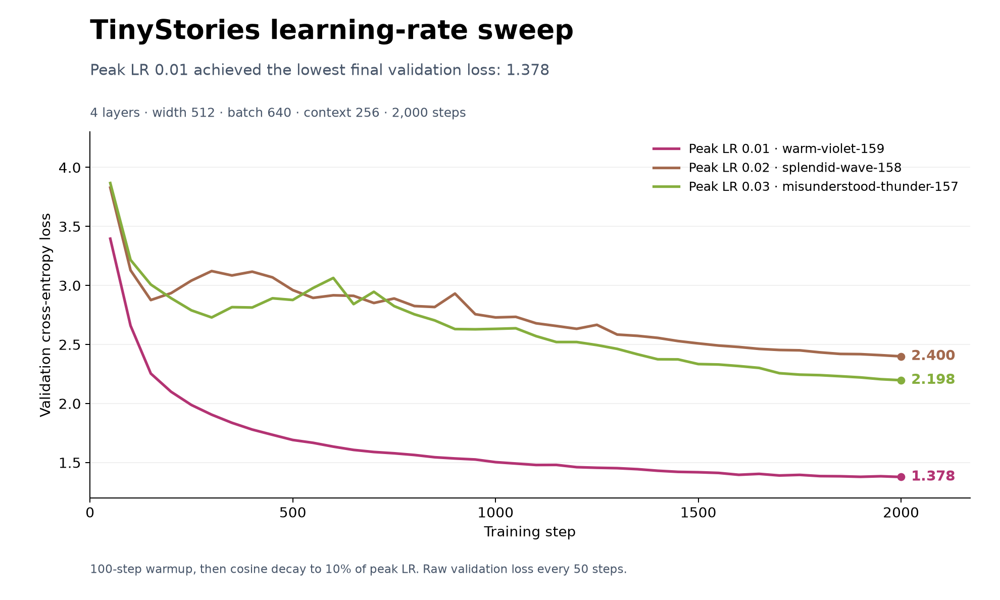

# Language Modeling from Scratch — CS336

My from-scratch implementation of Stanford CS336 Assignment 1, building and training a Transformer LM in PyTorch.



Across three 2,000-step TinyStories runs, peak LR **0.01** achieved the lowest final validation loss: **1.378**, compared with **2.400** at 0.02 and **2.198** at 0.03. All three used 100 warmup steps followed by cosine decay to 10% of peak LR, with the same model, batch size, and context length.

W&B runs: [warm-violet-159 · LR 0.01](https://forge.coreweave.com/wandb/alephnott/assignment1/runs/l5dba839), [splendid-wave-158 · LR 0.02](https://forge.coreweave.com/wandb/alephnott/assignment1/runs/tiuyf0cn), [misunderstood-thunder-157 · LR 0.03](https://forge.coreweave.com/wandb/alephnott/assignment1/runs/cwe96lt3).

## Current progress

| Component | Status |
| --- | --- |
| BPE training and tokenizer | Built |
| Linear projection and embedding lookup | Built |
| RMSNorm and SwiGLU feed-forward network | Built |
| Causal multi-head attention and RoPE | Built |
| Transformer blocks and complete language model | Built |
| Cross-entropy loss and AdamW optimizer | Built |
| Cosine learning-rate schedule and gradient clipping | Built |
| Data loading, training loop, and checkpointing | Built |
| Text generation with temperature and top-p sampling | Built |
| Experiments | In progress |
| Leaderboard run | In progress |

Full-suite validation with `uv run pytest` on October 13, 2026 (macOS, Python 3.12): **42 passed, 4 failed, 2 skipped**. The failures are the RoPE, attention-with-RoPE, Transformer-block, and SiLU adapter tests; the skips are Linux-only memory tests.

## Explore the work

- [Transformer implementation](cs336_basics/gpt.py): model layers, attention, RoPE, and the complete language model.
- [BPE training](cs336_basics/bpe.py) and [tokenizer](cs336_basics/tokenizer.py).
- [Training and generation](cs336_basics/pretrain.py): optimizer, learning-rate schedule, gradient clipping, checkpointing, and sampling.
- [Compute and memory estimates](cs336_basics/resource_accounting.py).
- [Test adapters](tests/adapters.py) connecting the implementations to the supplied course tests.

## Run with uv

```sh
uv sync --locked
uv run pytest
```

Training uses locally prepared tokenized datasets. Dataset and checkpoint paths are configured in [pretrain.py](cs336_basics/pretrain.py). Large datasets, checkpoints, virtual environments, and local W&B logs are excluded from Git.

## Course context

Based on the [Stanford CS336 assignment starter](https://github.com/stanford-cs336/assignment1-basics). See the [original course README](docs/COURSE_README.md), [assignment handout](cs336_assignment1_basics.pdf), and [course website](https://cs336.stanford.edu/) for requirements and data-download instructions.

All training code was written by me. AI was used only for conceptual understanding and general administrative work.

Original course materials retain their attribution, history, and [MIT license](LICENSE).
