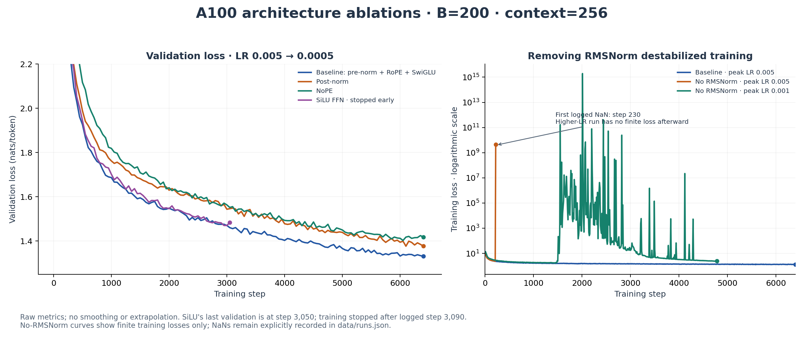

# A100 ablations: normalization, position and feed-forward gating

[Experiment index](README.md) · [Hardware tuning](hardware-tuning.md) · [Curated run data](data/runs.json)

**The pre-norm + RMSNorm + RoPE + SwiGLU baseline achieved the lowest final validation loss among the completed standard-LR ablations.** Removing normalization caused severe instability. SiLU was stopped early and is compared only at matched steps.



## Baseline and common configuration

The primary baseline is **[valiant-yogurt-171](https://wandb.ai/alephnott/assignment1/runs/rukvkasi)**: A100-SXM4 40 GB, B=200, 6,400 iterations, peak LR 0.005, minimum LR 0.0005, warmup 320, cosine endpoint 6,399, and checkpoint interval 640. The run sampled **327.68M training tokens**. Validation averages 10 batches every 50 steps.

The model has four layers, width 512, 16 heads, context length 256 and vocabulary size 10,000. The baseline uses SwiGLU width 1,344, RoPE theta 10,000, RMSNorm before both sublayers, and a final RMSNorm before the output projection. AdamW defaults in the trainer are β=(0.9, 0.999), ε=1e-8 and weight decay=0.01; gradient clipping is 1.0. Optimizer settings are source defaults rather than logged config fields.

The additional same-config baseline **[fallen-resonance-189](https://wandb.ai/alephnott/assignment1/runs/wq8n3e13)** was stopped after logged step 2,070 (last validation 1.5326 at step 2,050). It provides an early repeat, not a second full-budget baseline. Its W&B state is `failed` following the interrupted run/sync; this is not evidence of model divergence.

## Completed, matched-budget comparisons

| Variant | Change from baseline | Final validation @ 6,400 | Perplexity | Perplexity vs baseline |
|---|---|---:|---:|---:|
| [valiant-yogurt-171](https://wandb.ai/alephnott/assignment1/runs/rukvkasi) | Pre-norm + RMSNorm + RoPE + SwiGLU | 1.3308 | 3.784 | — |
| [postnorm-b200-lr005-20261021](https://wandb.ai/alephnott/assignment1/runs/szyqbc8p) | Normalize after each residual addition; remove final normalization call | 1.3771 | 3.964 | +4.75% |
| [nope-b200-lr005-20261021](https://wandb.ai/alephnott/assignment1/runs/p4pdtnnc) | Disable RoPE; keep pre-norm and SwiGLU | 1.4183 | 4.130 | +9.14% |

The final gap is not just one evaluation sample: mean validation loss across the nine evaluations from step 6,000 through 6,400 is **1.3358 baseline**, **1.3888 post-norm**, and **1.4154 NoPE**. Post-norm and NoPE both trained without logged non-finite losses. The post-norm gap narrowed during training; this configuration shows an optimization/quality difference rather than outright divergence.

Post-norm still uses RoPE and SwiGLU. NoPE still uses pre-norm and the final RMSNorm. These are separate ablations, not cumulative modifications. The unused `self.norm` declaration in the post-norm snapshot is never called and does not normalize the output.

## SwiGLU → SiLU: an early-stopped comparison

Run: **[silu-b200-lr005-20261021](https://wandb.ai/alephnott/assignment1/runs/2yayrk3n)**. It keeps pre-norm and RoPE but replaces the gated SwiGLU FFN with a two-matrix SiLU FFN and increases `d_ff` to **2,048 = 4 × 512**. This approximately matches FFN parameter count: 2,097,152 parameters per SiLU FFN versus 2,064,384 per SwiGLU FFN (SiLU is about 1.59% larger). It is not an exactly parameter-matched comparison.

| Matched validation step | SwiGLU baseline | SiLU | SiLU − baseline |
|---:|---:|---:|---:|
| 1,000 | 1.6867 | 1.7019 | +0.0152 |
| 1,800 | 1.5559 | 1.5853 | +0.0294 |
| 3,000 | 1.4702 | 1.4702 | −0.00003 |
| 3,050 | 1.4604 | 1.4835 | +0.0230 |

Training was deliberately stopped after **logged step 3,090**; its last validation is at **3,050**, not 3,090. W&B records the terminated process as `crashed`. The last matched validation gap corresponds to **2.33% higher perplexity**, but SiLU nearly tied the baseline at step 3,000. Its mean matched-step behavior is more informative than calling it uniformly worse, and it has **no 6,400-step result**. The remaining budget was not spent, so do not compare 1.4835 directly with the baseline's 6,400-step score as a final-budget result.

The archived SiLU implementation computes the first projection once; that correction was synced before this run started.

## Removing RMSNorm: instability and a lower-LR retry

| Run | LR max → min | Outcome |
|---|---|---|
| [flowing-hill-190](https://wandb.ai/alephnott/assignment1/runs/ogzm51yj) | 0.005 → 0.0005 | First logged non-finite training loss at step **230**; NaNs continued through last logged step **6,140** |
| [smooth-plasma-191](https://wandb.ai/alephnott/assignment1/runs/ol070jon) | 0.001 → 0.0001 | Best logged validation **1.7616 at step 1,400**, followed by severe loss spikes; last validation **2.4155 at step 4,750**, last training log at **4,780** |

These runs removed RMSNorm by making its forward computation an identity, including the model's final normalization. Both W&B runs are marked `crashed`; those end states alone are not the evidence—the recorded loss trajectories are. The lower-LR retry remained numerically finite in the logged loss samples but was still unstable. Since that retry changes LR as well as normalization, it is a recovery experiment, not a matched-LR ablation. Exact source snapshots for these two older runs were not retained; they are documented from the experiment record and W&B metrics rather than reconstructed as if they were original files.

## Code and reproduction

| Variant | Model source | Training entry point |
|---|---|---|
| Baseline | [gpt.py](../cs336_basics/gpt.py) | [pretrain_baseline.py](pretrain_baseline.py) |
| Post-norm | [models/postnorm.py](models/postnorm.py) | [pretrain_postnorm.py](pretrain_postnorm.py) |
| NoPE | [models/nope.py](models/nope.py) | [pretrain_nope.py](pretrain_nope.py) |
| SiLU | [models/silu.py](models/silu.py) | [pretrain_silu.py](pretrain_silu.py) |

The three model files were moved from `cs336_basics/` without changing their computations. Training entry points preserve the existing user-written loop with imports/defaults adjusted for the archived variant and CUDA/Inductor. They are reproduction entry points, not a claim that byte-for-byte copies of all original server launch files were recovered. Keep the full CLI settings below: the trainer's standalone defaults are not the 6,400-step experiment configuration.

From the repository root, with the existing tokenizer and TinyStories arrays in `out/`:

```sh
uv sync --locked
uv run python -m experiments.pretrain_postnorm \
  --device cuda --vocab_size 10000 --d_model 512 --d_ff 1344 \
  --batch_size 200 --lr_max 0.005 --lr_min 0.0005 \
  --t 6400 --t_c 6399 --t_w 320 --save_every 640
```

Use `experiments.pretrain_baseline` or `experiments.pretrain_nope` with the same flags. For SiLU use `experiments.pretrain_silu` and **`--d_ff 2048`**. Configure `WANDB_ENTITY`, `WANDB_PROJECT`, and optional `WANDB_NAME` in your environment or the ignored root `.env`; see [.env.example](../.env.example). Credentials, datasets and checkpoints are not included. These entry points use CUDA/Inductor; they are not MacBook launchers.

The saved `ckpt_final.pt` filename is reused at checkpoint intervals, and the existing trainer writes the planned total `cfg.t` into its checkpoint iteration field. For interrupted runs, do not infer actual progress from that field or filename; use the W&B step history. The logged Git commit also does not capture working-tree edits. Validation batches are sampled rather than a fixed exhaustive validation set, and these are single runs without controlled repeated seeds. The results support conclusions for this configuration, not universal architecture rankings.
