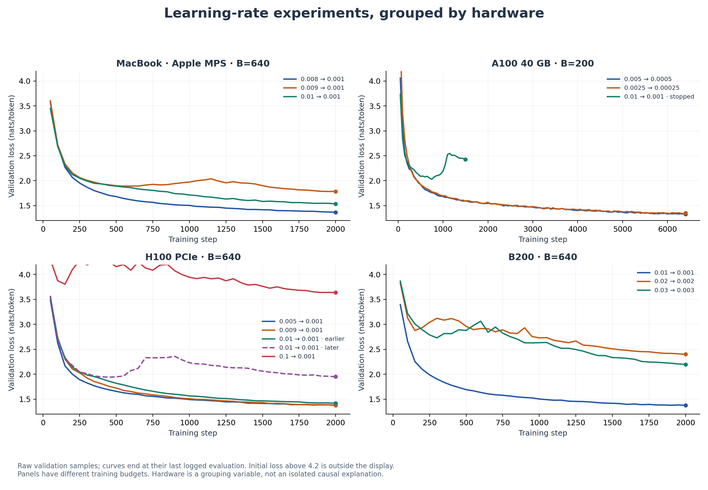
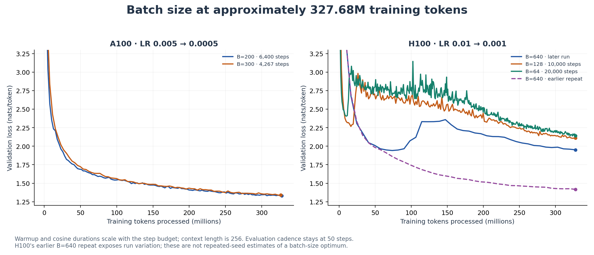

# Hardware tuning: learning rate and batch size

[Experiment index](README.md) · [A100 architecture ablations](a100-ablations.md) · [Curated run data](data/runs.json)

These experiments identify useful configurations **within each hardware group**. They are not a controlled benchmark of hardware speed or a claim that hardware alone determines the best learning rate. Model revisions, numerical settings, random initialization, data samples, evaluation overhead, and software environments can also affect the outcome.

## At a glance

| Hardware | Strongest completed result among the selected standard-model runs | Configuration | Scope |
|---|---:|---|---|
| MacBook / Apple MPS | 1.3686 | B=640, LR 0.008→0.001, 2,000 steps | Best of the three completed local LR runs |
| A100-SXM4 40 GB | 1.3308 | B=200, LR 0.005→0.0005, 6,400 steps | Baseline for the A100 ablations |
| H100 PCIe | 1.3791 | B=640, LR 0.009→0.001, 2,000 steps | Repeated configs show substantial variation |
| NVIDIA B200 | 1.3782 | B=640, LR 0.01→0.001, 2,000 steps | Best of the completed 0.01 / 0.02 / 0.03 sweep |

All scores are last logged validation cross-entropy, in nats/token; lower is better. These rows summarize separate experiments, not a hardware ranking.

## Shared model and measurement conventions

The selected runs use TinyStories, a 10,000-token vocabulary, context length 256, four layers, model width 512, 16 attention heads, and SwiGLU width 1,344. The standard model uses pre-RMSNorm, a final RMSNorm, and RoPE with theta 10,000. The archived A100 variants are documented separately.

Unless called out below: AdamW defaults in the trainer are β=(0.9, 0.999), ε=1e-8 and weight decay=0.01; gradient clipping is 1.0; validation averages 10 sampled batches every 50 training steps. The cosine endpoint is `t_c=t−1`; warmup occupies approximately 5% of the steps. Optimizer defaults are source-code settings, not fields logged in these W&B configs. Exact exported configs and raw curves are in [runs.json](data/runs.json).

Runtime is W&B's reported run duration, including startup, compilation, evaluation, saving and logging. It is not pure training throughput. The Mac metadata records MPS and macOS/ARM64, but not a chip model. The B200 metadata explicitly reports **NVIDIA B200 on an x86_64 host**: the earlier “GB200” label is not supported as a system identity, so this report uses the recorded GPU name. CUDA devices were logged as one GPU per run.

## MacBook / Apple MPS

### Learning-rate tuning

With B=640 and 2,000 steps (327.68M sampled training tokens), **0.008→0.001 produced the lowest final loss of these completed runs**. The 0.009 result is worse than both neighboring rates; this is evidence against treating one short sweep as a smooth, definitive optimum. All three keep the same LR floor, so it is not always 10% of the peak.

| Run | B | LR max → min | Planned steps / warmup | Last validation @ step | Logged state | Runtime |
|---|---:|---|---:|---|---|---:|
| [comic-cherry-166](https://wandb.ai/alephnott/assignment1/runs/rnoc2pxe) | 640 | 0.008 → 0.001 | 2,000 / 100 | 1.3686 @ 2,000 | finished | 173.5 min |
| [skilled-salad-167](https://wandb.ai/alephnott/assignment1/runs/hiytf04j) | 640 | 0.009 → 0.001 | 2,000 / 100 | 1.7854 @ 2,000 | finished | 167.2 min |
| [serene-sky-163](https://wandb.ai/alephnott/assignment1/runs/wx9o9huh) | 640 | 0.01 → 0.001 | 2,000 / 100 | 1.5371 @ 2,000 | finished | 172.2 min |

Two higher-LR probes were stopped early. Their last losses are not directly comparable to the completed runs, but their curves preserve the exploration boundary:

| Run | B | LR max → min | Planned steps / warmup | Last validation @ step | Logged state | Runtime |
|---|---:|---|---:|---|---|---:|
| [eager-night-165](https://wandb.ai/alephnott/assignment1/runs/8p4qvkmv) | 640 | 0.0125 → 0.001 | 2,000 / 100 | 2.7805 @ 350 | Stopped early | 32.6 min |
| [ethereal-salad-164](https://wandb.ai/alephnott/assignment1/runs/al9brqzb) | 640 | 0.015 → 0.001 | 2,000 / 100 | 2.8301 @ 250 | Stopped early | 24.1 min |

### Smaller-batch history: a schedule confound

| Run | B | LR max → min | Planned steps / warmup | Last validation @ step | Logged state | Runtime |
|---|---:|---|---:|---|---|---:|
| [bumbling-brook-124](https://wandb.ai/alephnott/assignment1/runs/um9cad88) | 32 | 0.001 → 0.0001 | 50,000 / 5 | 1.4671 @ 50,000 | finished | 176.5 min |

The B=32 run demonstrates that a long local run reached validation loss 1.4671, but its config has **`t_w=5` and `t_c=6` despite `t=50,000`**. Under the trainer's schedule, almost all steps therefore use `lr_min=0.0001`. It also processes 409.6M tokens and evaluates every 1,000 steps; its clipping threshold is not recorded. Comparing it with the B=640 runs would change batch size, LR schedule, token budget and evaluation cadence together. There is **no clean MacBook batch-size optimum established by these runs**.

## A100-SXM4 40 GB

### Learning-rate tuning at B=200

**0.005→0.0005 beat 0.0025→0.00025** at the same 6,400-step budget. The higher-rate 0.01 run improved initially, then deteriorated and was stopped after logged step 1,510. Its best logged validation was about 2.0304 at step 750, versus its last 2.4244 at step 1,500.

| Run | B | LR max → min | Planned steps / warmup | Last validation @ step | Logged state | Runtime |
|---|---:|---|---:|---|---|---:|
| [valiant-yogurt-171](https://wandb.ai/alephnott/assignment1/runs/rukvkasi) | 200 | 0.005 → 0.0005 | 6,400 / 320 | 1.3308 @ 6,400 | finished | 54.2 min |
| [vivid-capybara-172](https://wandb.ai/alephnott/assignment1/runs/jwu7v6h0) | 200 | 0.0025 → 0.00025 | 6,400 / 320 | 1.3553 @ 6,400 | finished | 54.2 min |
| [blooming-galaxy-170](https://wandb.ai/alephnott/assignment1/runs/bse95z37) | 200 | 0.01 → 0.001 | 6,400 / 320 | 2.4244 @ 1,500 | Stopped early | 13.0 min |

The LR floor changes alongside the peak in this sweep. The selected baseline is **[valiant-yogurt-171](https://wandb.ai/alephnott/assignment1/runs/rukvkasi)**, not a claim that 0.005 is globally optimal.

### Batch size at a matched token budget

| Run | B | LR max → min | Planned steps / warmup | Last validation @ step | Logged state | Runtime |
|---|---:|---|---:|---|---|---:|
| [valiant-yogurt-171](https://wandb.ai/alephnott/assignment1/runs/rukvkasi) | 200 | 0.005 → 0.0005 | 6,400 / 320 | 1.3308 @ 6,400 | finished | 54.2 min |
| [lively-brook-173](https://wandb.ai/alephnott/assignment1/runs/wy5g0wte) | 300 | 0.005 → 0.0005 | 4,267 / 213 | 1.3399 @ 4,250 | finished | 54.3 min |

B=200 × 6,400 and B=300 × 4,267 process approximately the same 327.68M tokens. Both use LR 0.005→0.0005; warmup scales from 320 to 213 steps. B=200's final validation is 0.0091 lower, while reported runtimes are essentially equal (about 54 minutes). This small single-run difference does **not** establish a reliable quality or speed advantage. The B=300 run finished 4,267 iterations, but its last validation is at **4,250** because evaluation runs every 50 steps; the last logged training metric is at 4,260.

## H100 PCIe

### Learning-rate tuning and repeated configurations

| Run | B | LR max → min | Planned steps / warmup | Last validation @ step | Logged state | Runtime |
|---|---:|---|---:|---|---|---:|
| [celestial-breeze-185](https://wandb.ai/alephnott/assignment1/runs/1sjic7ym) | 640 | 0.005 → 0.001 | 2,000 / 100 | 1.3827 @ 2,000 | finished | 30.8 min |
| [decent-water-174](https://wandb.ai/alephnott/assignment1/runs/z5qphq7w) | 640 | 0.009 → 0.001 | 2,000 / 100 | 1.3991 @ 2,000 | finished | 31.5 min |
| [distinctive-sun-183](https://wandb.ai/alephnott/assignment1/runs/4lq9tn3g) | 640 | 0.009 → 0.001 | 2,000 / 100 | 1.3791 @ 2,000 | finished | 31.1 min |
| [sage-silence-175](https://wandb.ai/alephnott/assignment1/runs/n0a7jkyg) | 640 | 0.01 → 0.001 | 2,000 / 100 | 1.4178 @ 2,000 | finished | 30.4 min |
| [stellar-dawn-186](https://wandb.ai/alephnott/assignment1/runs/753n2zbh) | 640 | 0.01 → 0.001 | 2,000 / 100 | 1.9512 @ 2,000 | finished | 30.6 min |
| [clear-gorge-184](https://wandb.ai/alephnott/assignment1/runs/5inlca2c) | 640 | 0.1 → 0.001 | 2,000 / 100 | 3.6396 @ 2,000 | finished | 30.4 min |

At B=640 and 2,000 steps, 0.005 and 0.009 reached roughly 1.38–1.40 validation loss. The extreme LR 0.1 run ended at 3.6396. However, **the identical logged 0.01 configuration produced 1.4178 in the earlier run and 1.9512 in the later one**. Both results are retained. The two 0.009 runs also differ (1.3991 versus 1.3791). These are configuration repeats, not controlled repeated-seed experiments: seeds and all working-tree/code changes were not tracked. The H100 history supports a useful LR range, not an exact optimum or a hardware-specific explanation for the variation.

### Batch size at a matched token budget

| Run | B | LR max → min | Planned steps / warmup | Last validation @ step | Logged state | Runtime |
|---|---:|---|---:|---|---|---:|
| [stellar-dawn-186](https://wandb.ai/alephnott/assignment1/runs/753n2zbh) | 640 | 0.01 → 0.001 | 2,000 / 100 | 1.9512 @ 2,000 | finished | 30.6 min |
| [wise-grass-187](https://wandb.ai/alephnott/assignment1/runs/5xkb83pk) | 128 | 0.01 → 0.001 | 10,000 / 500 | 2.1100 @ 10,000 | finished | 31.8 min |
| [efficient-glitter-188](https://wandb.ai/alephnott/assignment1/runs/6tx3lj83) | 64 | 0.01 → 0.001 | 20,000 / 1,000 | 2.1415 @ 20,000 | finished | 33.8 min |

All three process 327.68M tokens with LR 0.01→0.001 and 5% warmup: B=640 × 2,000, B=128 × 10,000, and B=64 × 20,000. In this later sequence, larger batches finished with lower loss and shorter reported wall time. But reducing B without retuning LR can alter optimization, and evaluating every 50 steps means smaller batches incur more evaluation rounds. The earlier B=640 repeat (1.4178) is shown in the figure as well; it makes the unexplained between-run variation visible.

## B200 (previously referred to as GB200)

### Completed learning-rate sweep

| Run | B | LR max → min | Planned steps / warmup | Last validation @ step | Logged state | Runtime |
|---|---:|---|---:|---|---|---:|
| [warm-violet-159](https://wandb.ai/alephnott/assignment1/runs/l5dba839) | 640 | 0.01 → 0.001 | 2,000 / 100 | 1.3782 @ 2,000 | finished | 18.7 min |
| [splendid-wave-158](https://wandb.ai/alephnott/assignment1/runs/tiuyf0cn) | 640 | 0.02 → 0.002 | 2,000 / 100 | 2.3997 @ 2,000 | finished | 18.6 min |
| [misunderstood-thunder-157](https://wandb.ai/alephnott/assignment1/runs/cwe96lt3) | 640 | 0.03 → 0.003 | 2,000 / 100 | 2.1976 @ 2,000 | finished | 18.5 min |

These three completed runs share B=640, 2,000 steps, 100 warmup steps and a cosine endpoint of 1,999. The LR floor is 10% of the peak. **0.01 clearly outperformed 0.02 and 0.03** in this sweep. This is the sweep previously featured at the top of the repository. There is no informative B200 batch-size sweep in the retained records, so no batch-size optimum is claimed for it.

## Selection and reproducibility

The audit covered 184 W&B runs; this archive retains 27 that inform LR choice, batch-size behavior, schedule pitfalls, repeat variability or the A100 ablations. Ten-step smoke tests, setup failures, obsolete small-model/other-vocabulary experiments and redundant early interruptions are omitted. Poor and non-finite results are retained when they are the signal of the experiment.

Hardware labels come from W&B metadata, not inferred from `device=cuda`. Configs match where stated, but a logged Git commit does not capture uncommitted changes on a training host. These comparisons are descriptive evidence from the runs, not statistical significance tests. Regenerate all figures with `uv run experiments/plot_results.py`.
